---
hide:
  - navigation
---

# Processing

### Download OSM data from a query around an area

Fetch the OSM data that match the request.

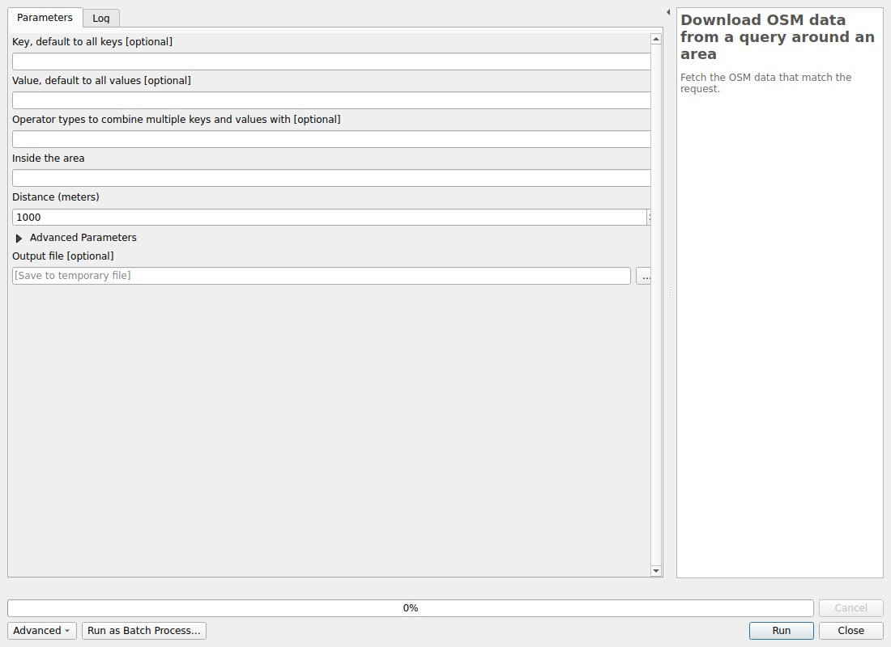

#### Parameters

| ID | Description | Type | Info | Required | Advanced | Option |
|:-:|:-:|:-:|:-:|:-:|:-:|:-:|
KEY|Key, default to all keys|String|The OSM key to use. It can be empty and it will default to all keys. Multiple keys can be ask by adding the separator ',' between each key. In this case make sure the number of keys match the number of values||||
VALUE|Value, default to all values|String|The OSM value to use. It can be empty and it will default to all values.Multiple values can be ask by adding the separator ',' between each value. In this case make sure the number of values match the number of keys||||
TYPE_MULTI_REQUEST|Operator types to combine multiple keys and values with|String|The logical operators used to combine keys and values, if there are multiple.||||
AREA|Inside the area|String|The name of the area. This will make a first query to the Nominatim API to fetch the OSM ID.|✓|||
DISTANCE|Distance (meters)|Number|The distance to use when doing the buffering around the named area. The distance must be in meters.|✓||Default: 1000   Type: Integer  Min: 1  |
TIMEOUT|Timeout|Number|The timeout to use for the Overpass API.|✓|✓|Default: 25   Type: Integer  Min: 5  |
SERVER|Overpass server|String|The Overpass API server to use to build the encoded URL.|✓|✓|Default: https://overpass-api.de/api/interpreter   |
FILE|Output file|FileDestination|Path where the file will be download.||||

#### Outputs

| ID | Description | Type | Info |
|:-:|:-:|:-:|:-:|
FILE|Output file|File||
OUTPUT_POINTS|Output points|VectorLayer||
OUTPUT_LINES|Output lines|VectorLayer||
OUTPUT_MULTILINESTRINGS|Output multilinestrings|VectorLayer||
OUTPUT_MULTIPOLYGONS|Output multipolygons|VectorLayer||

***

### Download OSM data from a query in an extent

Fetch the OSM data that match the request.

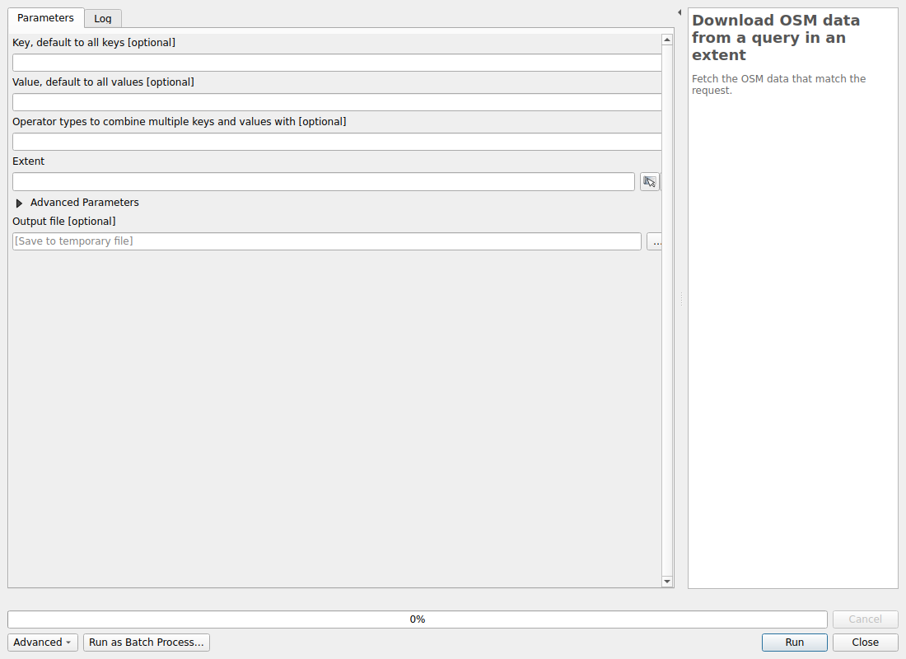

#### Parameters

| ID | Description | Type | Info | Required | Advanced | Option |
|:-:|:-:|:-:|:-:|:-:|:-:|:-:|
KEY|Key, default to all keys|String|The OSM key to use. It can be empty and it will default to all keys. Multiple keys can be ask by adding the separator ',' between each key. In this case make sure the number of keys match the number of values||||
VALUE|Value, default to all values|String|The OSM value to use. It can be empty and it will default to all values.Multiple values can be ask by adding the separator ',' between each value. In this case make sure the number of values match the number of keys||||
TYPE_MULTI_REQUEST|Operator types to combine multiple keys and values with|String|The logical operators used to combine keys and values, if there are multiple.||||
EXTENT|Extent|Extent|The extent as a rectangle to use when building the query.|✓|||
TIMEOUT|Timeout|Number|The timeout to use for the Overpass API.|✓|✓|Default: 25   Type: Integer  Min: 5  |
SERVER|Overpass server|String|The Overpass API server to use to build the encoded URL.|✓|✓|Default: https://overpass-api.de/api/interpreter   |
FILE|Output file|FileDestination|Path where the file will be download.||||

#### Outputs

| ID | Description | Type | Info |
|:-:|:-:|:-:|:-:|
FILE|Output file|File||
OUTPUT_POINTS|Output points|VectorLayer||
OUTPUT_LINES|Output lines|VectorLayer||
OUTPUT_MULTILINESTRINGS|Output multilinestrings|VectorLayer||
OUTPUT_MULTIPOLYGONS|Output multipolygons|VectorLayer||

***

### Download OSM data from query in an area

Fetch the OSM data that match the request.

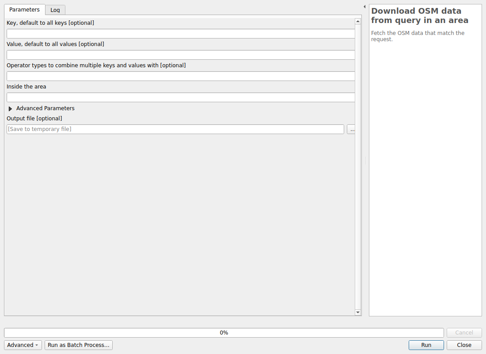

#### Parameters

| ID | Description | Type | Info | Required | Advanced | Option |
|:-:|:-:|:-:|:-:|:-:|:-:|:-:|
KEY|Key, default to all keys|String|The OSM key to use. It can be empty and it will default to all keys. Multiple keys can be ask by adding the separator ',' between each key. In this case make sure the number of keys match the number of values||||
VALUE|Value, default to all values|String|The OSM value to use. It can be empty and it will default to all values.Multiple values can be ask by adding the separator ',' between each value. In this case make sure the number of values match the number of keys||||
TYPE_MULTI_REQUEST|Operator types to combine multiple keys and values with|String|The logical operators used to combine keys and values, if there are multiple.||||
AREA|Inside the area|String|The name of the area. This will make a first query to the Nominatim API to fetch the OSM ID.|✓|||
TIMEOUT|Timeout|Number|The timeout to use for the Overpass API.|✓|✓|Default: 25   Type: Integer  Min: 5  |
SERVER|Overpass server|String|The Overpass API server to use to build the encoded URL.|✓|✓|Default: https://overpass-api.de/api/interpreter   |
FILE|Output file|FileDestination|Path where the file will be download.||||

#### Outputs

| ID | Description | Type | Info |
|:-:|:-:|:-:|:-:|
FILE|Output file|File||
OUTPUT_POINTS|Output points|VectorLayer||
OUTPUT_LINES|Output lines|VectorLayer||
OUTPUT_MULTILINESTRINGS|Output multilinestrings|VectorLayer||
OUTPUT_MULTIPOLYGONS|Output multipolygons|VectorLayer||

***

### Download OSM data from a not spatial query

Fetch the OSM data that match the request.

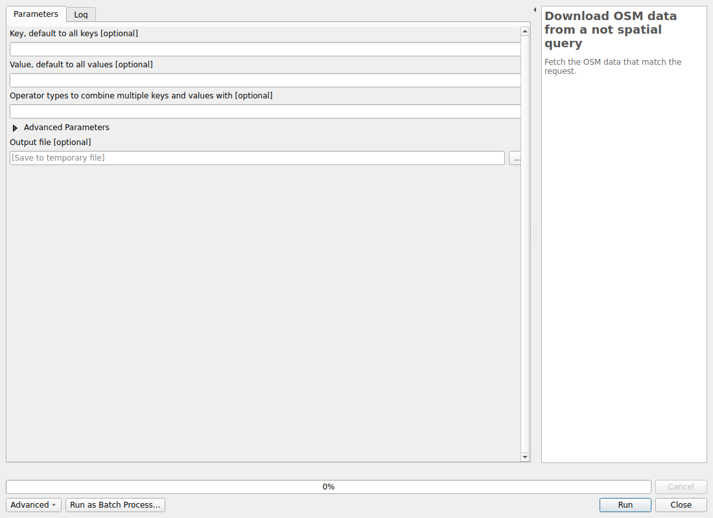

#### Parameters

| ID | Description | Type | Info | Required | Advanced | Option |
|:-:|:-:|:-:|:-:|:-:|:-:|:-:|
KEY|Key, default to all keys|String|The OSM key to use. It can be empty and it will default to all keys. Multiple keys can be ask by adding the separator ',' between each key. In this case make sure the number of keys match the number of values||||
VALUE|Value, default to all values|String|The OSM value to use. It can be empty and it will default to all values.Multiple values can be ask by adding the separator ',' between each value. In this case make sure the number of values match the number of keys||||
TYPE_MULTI_REQUEST|Operator types to combine multiple keys and values with|String|The logical operators used to combine keys and values, if there are multiple.||||
TIMEOUT|Timeout|Number|The timeout to use for the Overpass API.|✓|✓|Default: 25   Type: Integer  Min: 5  |
SERVER|Overpass server|String|The Overpass API server to use to build the encoded URL.|✓|✓|Default: https://overpass-api.de/api/interpreter   |
FILE|Output file|FileDestination|Path where the file will be download.||||

#### Outputs

| ID | Description | Type | Info |
|:-:|:-:|:-:|:-:|
FILE|Output file|File||
OUTPUT_POINTS|Output points|VectorLayer||
OUTPUT_LINES|Output lines|VectorLayer||
OUTPUT_MULTILINESTRINGS|Output multilinestrings|VectorLayer||
OUTPUT_MULTIPOLYGONS|Output multipolygons|VectorLayer||

***

### Download OSM data from a raw query

Fetch the OSM data that match the request.

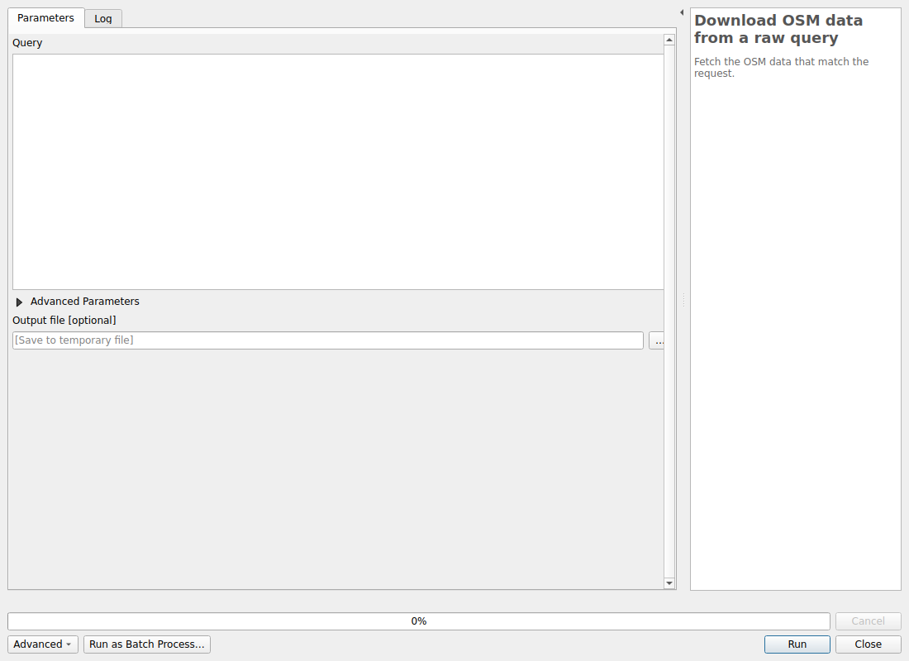

#### Parameters

| ID | Description | Type | Info | Required | Advanced | Option |
|:-:|:-:|:-:|:-:|:-:|:-:|:-:|
QUERY|Query|String|A XML or OQL query to be send to the Overpass API. It can contains some {{}} tokens.|✓|||
TIMEOUT|Timeout|Number|The timeout to use for the Overpass API.|✓|✓|Default: 25   Type: Integer  Min: 5  |
SERVER|Overpass server|String|The Overpass API server to use to build the encoded URL.|✓|✓|Default: https://overpass-api.de/api/interpreter   |
EXTENT|Extent, if "{{bbox}}" in the query|Extent|If the query has a {{bbox}} token, this extent will be used for replacement.||✓|Default: 0,1,0,1 []   |
AREA|Area (if {{geocodeArea}} in the query)|String|If the query has a {{geocodeArea}} token, this place will be used.||✓||
FILE|Output file|FileDestination|Path where the file will be download.||||

#### Outputs

| ID | Description | Type | Info |
|:-:|:-:|:-:|:-:|
FILE|Output file|File||
OUTPUT_POINTS|Output points|VectorLayer||
OUTPUT_LINES|Output lines|VectorLayer||
OUTPUT_MULTILINESTRINGS|Output multilinestrings|VectorLayer||
OUTPUT_MULTIPOLYGONS|Output multipolygons|VectorLayer||

***

## Advanced

### Build query around an area

This algorithm builds a query and then encode it into the Overpass API URL. The "Download File" algorithm might be used after that to fetch the result.

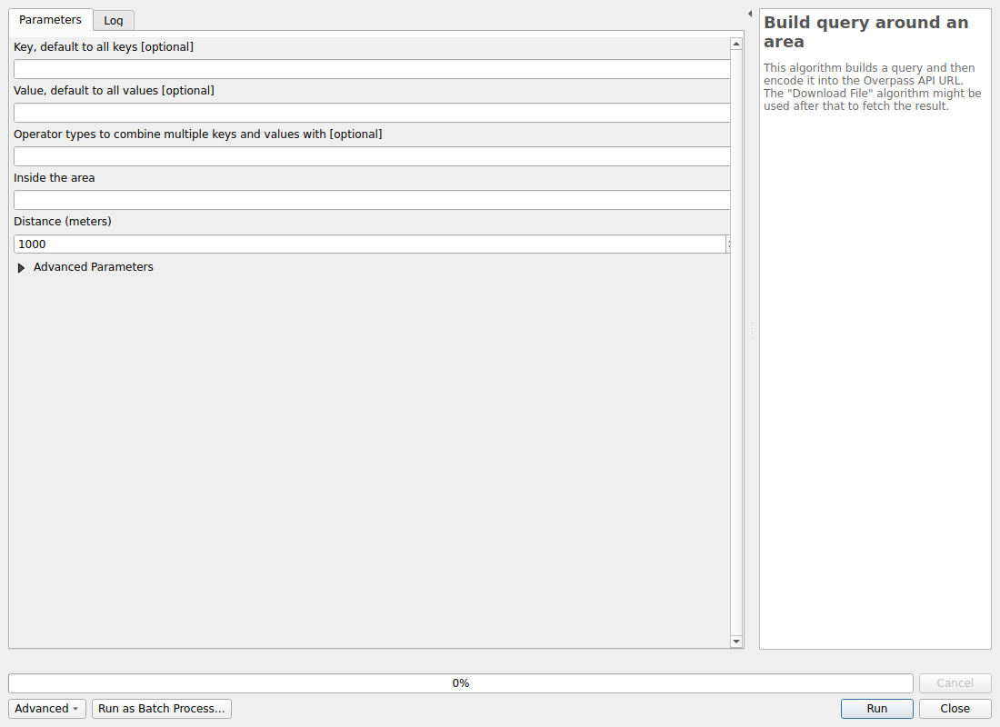

#### Parameters

| ID | Description | Type | Info | Required | Advanced | Option |
|:-:|:-:|:-:|:-:|:-:|:-:|:-:|
KEY|Key, default to all keys|String|The OSM key to use. It can be empty and it will default to all keys. Multiple keys can be ask by adding the separator ',' between each key. In this case make sure the number of keys match the number of values||||
VALUE|Value, default to all values|String|The OSM value to use. It can be empty and it will default to all values.Multiple values can be ask by adding the separator ',' between each value. In this case make sure the number of values match the number of keys||||
TYPE_MULTI_REQUEST|Operator types to combine multiple keys and values with|String|The logical operators used to combine keys and values, if there are multiple.||||
AREA|Inside the area|String|The name of the area. This will make a first query to the Nominatim API to fetch the OSM ID.|✓|||
DISTANCE|Distance (meters)|Number|The distance to use when doing the buffering around the named area. The distance must be in meters.|✓||Default: 1000   Type: Integer  Min: 1  |
TIMEOUT|Timeout|Number|The timeout to use for the Overpass API.|✓|✓|Default: 25   Type: Integer  Min: 5  |
SERVER|Overpass server|String|The Overpass API server to use to build the encoded URL.|✓|✓|Default: https://overpass-api.de/api/interpreter   |

#### Outputs

| ID | Description | Type | Info |
|:-:|:-:|:-:|:-:|
OUTPUT_URL|Query as encoded URL|String||
OUTPUT_OQL_QUERY|Raw query as OQL|String||

***

### Build query by attribute only

This algorithm builds a query and then encode it into the Overpass API URL. The "Download File" algorithm might be used after that to fetch the result.

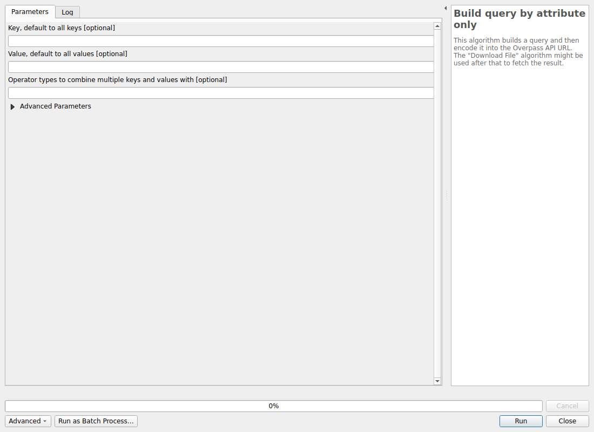

#### Parameters

| ID | Description | Type | Info | Required | Advanced | Option |
|:-:|:-:|:-:|:-:|:-:|:-:|:-:|
KEY|Key, default to all keys|String|The OSM key to use. It can be empty and it will default to all keys. Multiple keys can be ask by adding the separator ',' between each key. In this case make sure the number of keys match the number of values||||
VALUE|Value, default to all values|String|The OSM value to use. It can be empty and it will default to all values.Multiple values can be ask by adding the separator ',' between each value. In this case make sure the number of values match the number of keys||||
TYPE_MULTI_REQUEST|Operator types to combine multiple keys and values with|String|The logical operators used to combine keys and values, if there are multiple.||||
TIMEOUT|Timeout|Number|The timeout to use for the Overpass API.|✓|✓|Default: 25   Type: Integer  Min: 5  |
SERVER|Overpass server|String|The Overpass API server to use to build the encoded URL.|✓|✓|Default: https://overpass-api.de/api/interpreter   |

#### Outputs

| ID | Description | Type | Info |
|:-:|:-:|:-:|:-:|
OUTPUT_URL|Query as encoded URL|String||
OUTPUT_OQL_QUERY|Raw query as OQL|String||

***

### Build query inside an extent

This algorithm builds a query and then encode it into the Overpass API URL. The "Download File" algorithm might be used after that to fetch the result.

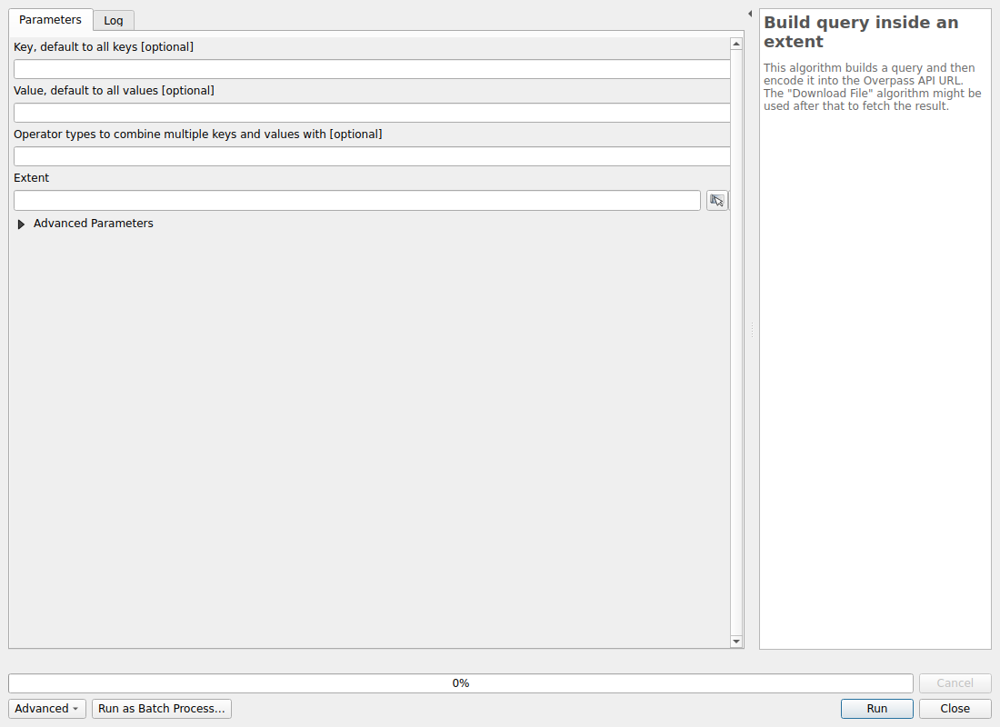

#### Parameters

| ID | Description | Type | Info | Required | Advanced | Option |
|:-:|:-:|:-:|:-:|:-:|:-:|:-:|
KEY|Key, default to all keys|String|The OSM key to use. It can be empty and it will default to all keys. Multiple keys can be ask by adding the separator ',' between each key. In this case make sure the number of keys match the number of values||||
VALUE|Value, default to all values|String|The OSM value to use. It can be empty and it will default to all values.Multiple values can be ask by adding the separator ',' between each value. In this case make sure the number of values match the number of keys||||
TYPE_MULTI_REQUEST|Operator types to combine multiple keys and values with|String|The logical operators used to combine keys and values, if there are multiple.||||
EXTENT|Extent|Extent|The extent as a rectangle to use when building the query.|✓|||
TIMEOUT|Timeout|Number|The timeout to use for the Overpass API.|✓|✓|Default: 25   Type: Integer  Min: 5  |
SERVER|Overpass server|String|The Overpass API server to use to build the encoded URL.|✓|✓|Default: https://overpass-api.de/api/interpreter   |

#### Outputs

| ID | Description | Type | Info |
|:-:|:-:|:-:|:-:|
OUTPUT_URL|Query as encoded URL|String||
OUTPUT_OQL_QUERY|Raw query as OQL|String||

***

### Build query inside an area

This algorithm builds a query and then encode it into the Overpass API URL. The "Download File" algorithm might be used after that to fetch the result.

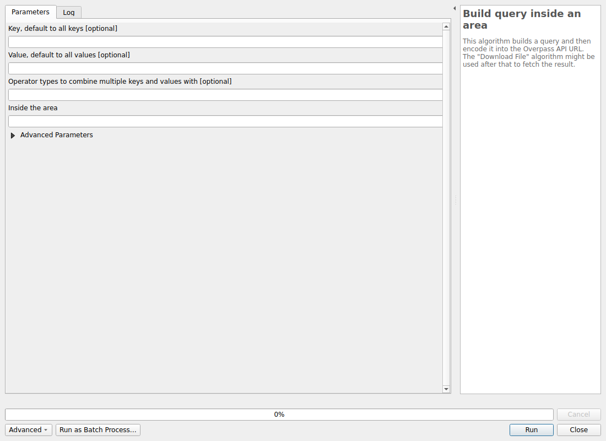

#### Parameters

| ID | Description | Type | Info | Required | Advanced | Option |
|:-:|:-:|:-:|:-:|:-:|:-:|:-:|
KEY|Key, default to all keys|String|The OSM key to use. It can be empty and it will default to all keys. Multiple keys can be ask by adding the separator ',' between each key. In this case make sure the number of keys match the number of values||||
VALUE|Value, default to all values|String|The OSM value to use. It can be empty and it will default to all values.Multiple values can be ask by adding the separator ',' between each value. In this case make sure the number of values match the number of keys||||
TYPE_MULTI_REQUEST|Operator types to combine multiple keys and values with|String|The logical operators used to combine keys and values, if there are multiple.||||
AREA|Inside the area|String|The name of the area. This will make a first query to the Nominatim API to fetch the OSM ID.|✓|||
TIMEOUT|Timeout|Number|The timeout to use for the Overpass API.|✓|✓|Default: 25   Type: Integer  Min: 5  |
SERVER|Overpass server|String|The Overpass API server to use to build the encoded URL.|✓|✓|Default: https://overpass-api.de/api/interpreter   |

#### Outputs

| ID | Description | Type | Info |
|:-:|:-:|:-:|:-:|
OUTPUT_URL|Query as encoded URL|String||
OUTPUT_OQL_QUERY|Raw query as OQL|String||

***

### Build raw query

A XML or OQL query to send to a Overpass API server.

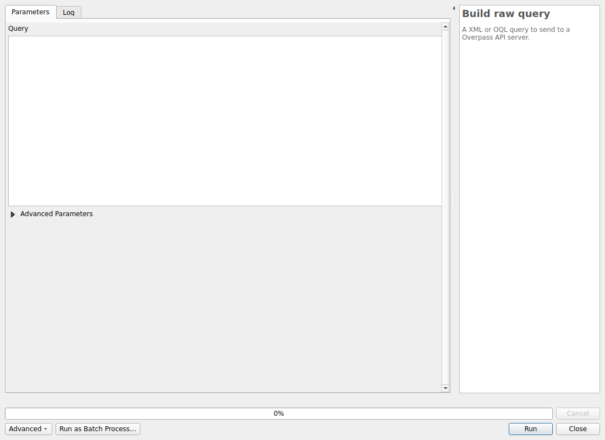

#### Parameters

| ID | Description | Type | Info | Required | Advanced | Option |
|:-:|:-:|:-:|:-:|:-:|:-:|:-:|
QUERY|Query|String|A XML or OQL query to be send to the Overpass API. It can contains some {{}} tokens.|✓|||
TIMEOUT|Timeout|Number|The timeout to use for the Overpass API.|✓|✓|Default: 25   Type: Integer  Min: 5  |
SERVER|Overpass server|String|The Overpass API server to use to build the encoded URL.|✓|✓|Default: https://overpass-api.de/api/interpreter   |
EXTENT|Extent, if "{{bbox}}" in the query|Extent|If the query has a {{bbox}} token, this extent will be used for replacement.||✓|Default: 0,1,0,1 []   |
AREA|Area (if {{geocodeArea}} in the query)|String|If the query has a {{geocodeArea}} token, this place will be used.||✓||

#### Outputs

| ID | Description | Type | Info |
|:-:|:-:|:-:|:-:|
OUTPUT_URL|Query as encoded URL|String||
OUTPUT_OQL_QUERY|Raw query as OQL|String||

***

### Decorate a layer from OSM

Decorate the layer as an QuickOSM output.

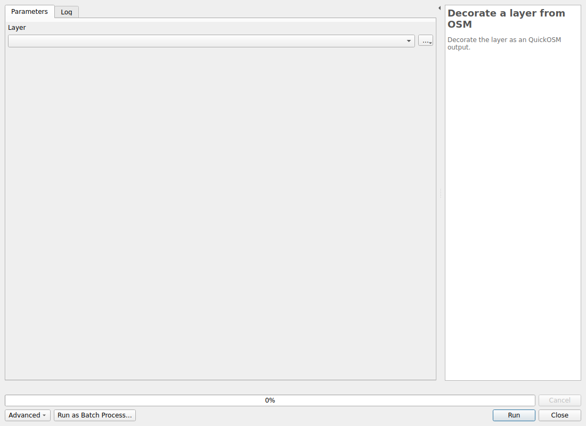

#### Parameters

| ID | Description | Type | Info | Required | Advanced | Option |
|:-:|:-:|:-:|:-:|:-:|:-:|:-:|
LAYER|Layer|VectorLayer|Path where the file will be download.|✓||Type:   |

#### Outputs

| ID | Description | Type | Info |
|:-:|:-:|:-:|:-:|
OUTPUT_LAYER|Output layer|VectorLayer||

***

### Open sublayers from an OSM file

Open all sub-layers from an OSM file. A custom OSM configuration file can be specified following the OGR documentation. This algorithm will not make a copy of the input file, it will only open it using OGR and custom INI file if provided.

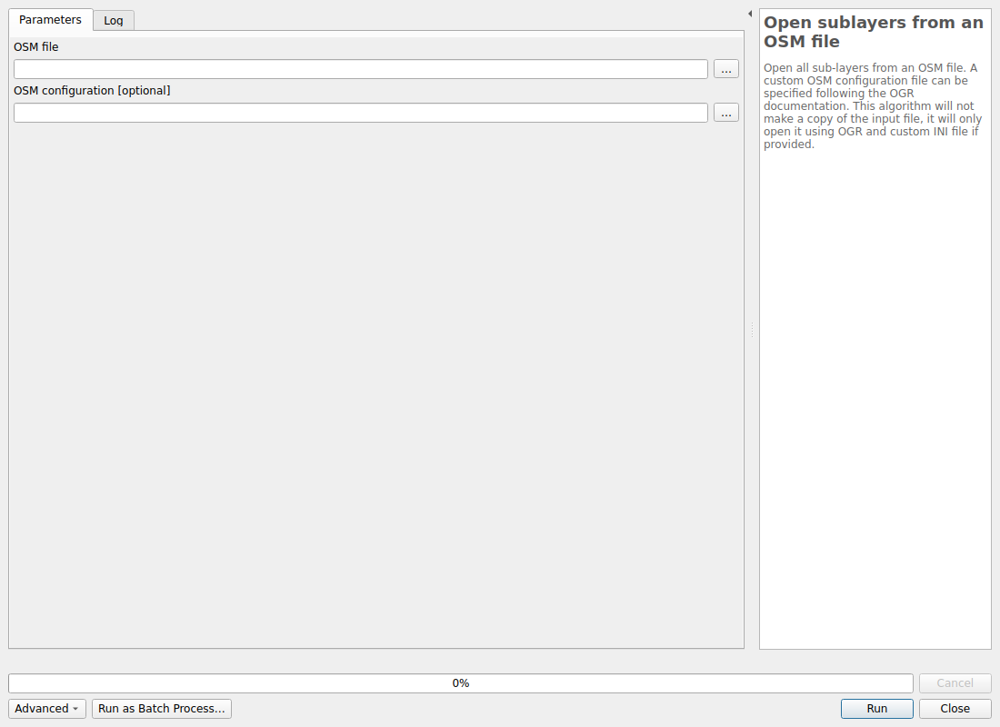

#### Parameters

| ID | Description | Type | Info | Required | Advanced | Option |
|:-:|:-:|:-:|:-:|:-:|:-:|:-:|
FILE|OSM file|File|The extension can be a OSM or PBF file.|✓|||
OSM_CONF|OSM configuration|File|The OGR OSM configuration file. This file is used to customize the import process about OSM tags. You should read the OGR documentation https://gdal.org/drivers/vector/osm.html||||

#### Outputs

| ID | Description | Type | Info |
|:-:|:-:|:-:|:-:|
OUTPUT_POINTS|Output points|VectorLayer||
OUTPUT_LINES|Output lines|VectorLayer||
OUTPUT_MULTILINESTRINGS|Output multilinestrings|VectorLayer||
OUTPUT_MULTIPOLYGONS|Output multipolygons|VectorLayer||
OUTPUT_OTHER_RELATIONS|Output other relations|VectorLayer||

***

